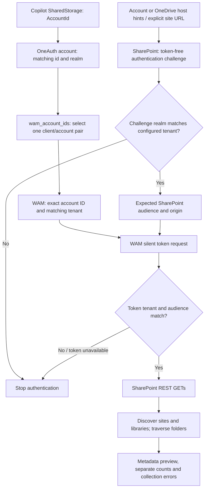
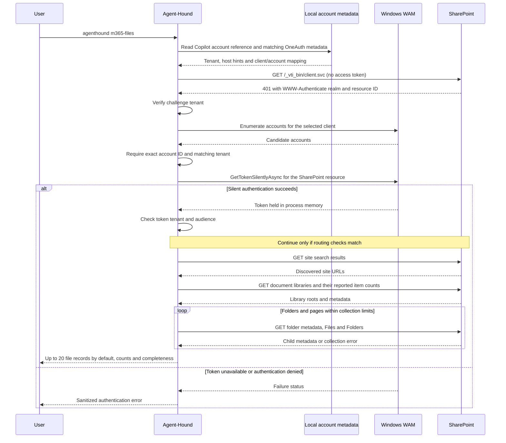

# Copilot authentication and SharePoint collection

The default `m365-files` collector uses Copilot's account references to select an existing Windows Web Account Manager (WAM) identity, obtains a service-specific token through the public Windows API, and reads SharePoint REST metadata. Authentication and HTTP collection run inside Agent-Hound's Python process. See [the command guide](m365-files.md) for setup, examples and output fields.

## Authentication flow

Local metadata identifies the account and requesting client. SharePoint's authentication challenge identifies the target tenant and service resource. These are separate inputs to the WAM request: the challenge's `client_id` is the SharePoint resource identifier, not the Copilot client ID.

An ambiguous client mapping requires explicit selection from the existing mapping. Missing or mismatched accounts fail before a token request. Collection errors are recorded separately from authentication failures.

## Account and client resolution

The adapter reads `HKCU\Software\Microsoft\Copilot\SharedStorage\Auth\AccountId` and locates exactly one bounded JSON account record under `%LOCALAPPDATA%\Microsoft\OneAuth\accounts` with a matching `id`. The record's `realm` supplies the tenant. A requested tenant must agree, and a nonempty signed-out marker blocks authentication.

The account's `additional_properties.wam_account_ids` maps client IDs to WAM account IDs. Both properties can contain JSON strings and are parsed accordingly. A single usable mapping supplies the client/account pair. Multiple mappings require an explicit `--copilot-client-id`, which must already exist in that record. The adapter does not hardcode a Copilot client ID or try alternative IDs after a denial.

A shared OneAuth mapping is evidence for account selection, not proof that every mapped client belongs to the active Copilot build. An explicit client selection must be checked against the installed configuration. WAM account enumeration must return exactly one matching `WebAccount.id` with the expected `TenantId`; display names and account order are not selection keys.

## Host and resource verification

Host candidates come from the account's `onmicrosoft.com` domain or OneDrive business-account endpoint metadata. These hints can be incomplete, particularly for custom domains or renamed tenants. An explicit site URL supplies the host when discovery cannot resolve it. The implementation currently accepts public-cloud `https://*.sharepoint.com` hosts.

Before sending a token, the collector makes a token-free GET to `https://<host>/_vti_bin/client.svc` with an empty Bearer header. The expected HTTP 401 challenge supplies `realm` and `client_id` through `WWW-Authenticate`. The realm must match the configured tenant; the returned service ID supplies the expected audience. The audience is therefore resolved from the target host rather than hardcoded.

The [SharePoint protocol specification](https://learn.microsoft.com/en-us/openspecs/sharepoint_protocols/ms-sps2sauth/05f9759b-0fa4-45ff-bd4b-0d7d254e7010) describes these challenge fields. The collector uses them for discovery, then authenticates through Entra/WAM. It does not implement that specification's server-to-server token flow or the retired ACS authentication flow.

## Token request and lifetime

The adapter calls WAM with the resolved client, exact account, tenant-specific authority and `resource=https://<host>`. The SharePoint request uses an empty WAM scope string and performs silent authentication only. WAM and Entra determine whether existing authorization permits issuance. The [Microsoft WAM example](https://learn.microsoft.com/en-us/windows/uwp/security/web-account-manager) documents resource selection through the request's `resource` property.

Tokens remain in process memory. Decoded JWT `tid` and `aud` claims are routing checks against the configured tenant and discovered resource/origin. They are not local signature verification; SharePoint authenticates and authorizes the request. Opaque tokens cannot pass the routing guard. Graph uses a separate audience and token provider.

The adapter does not register applications, initiate interactive login or consent, invoke external authentication CLIs, decrypt cookies, inspect credential blobs or call private Copilot DLL interfaces. Provider errors are sanitized before display; token bodies and raw authentication responses are not saved.

## Request sequence

The sequence below shows the automatic-discovery path for one SharePoint origin. Tokens can be reused in memory within that origin's session; each additional origin undergoes its own tenant/resource verification. WAM manages any cache or identity-provider interaction behind its public API.

Default traversal stops at the preview limit or traversal budget. `--enumerate-all` continues counting discovered locations while retaining the output limit. Neither path requests document bodies, so a listed-file count does not establish content access.

## Site and file collection

| Stage | Read API | Purpose |
|---|---|---|
| Site discovery | `/_api/search/query` | Find site/web search results visible to the current identity. |
| Library discovery | `/_api/web/lists` with `BaseType eq 1` | Obtain library roots and reported `ItemCount` values. |
| Folder resolution | `GetFolderByServerRelativePath(decodedUrl=...)` | Bind a decoded path to a folder identity. |
| Child enumeration | Folder `Files` and `Folders` collections | Read metadata and traverse subfolders. |

Microsoft documents the [file/folder REST APIs](https://learn.microsoft.com/en-us/sharepoint/dev/sp-add-ins/working-with-folders-and-files-with-rest) and [ResourcePath handling](https://learn.microsoft.com/en-us/sharepoint/dev/solution-guidance/supporting-and-in-file-and-folder-with-the-resourcepath-api). OData quotes are escaped before URL encoding, and returned item paths must remain immediate children of the requested folder.

Each discovered host undergoes tenant/resource verification. Authenticated requests remain on that exact origin, redirects are rejected, and pagination must stay on the same collection endpoint. Response-size, page, item and traversal limits bound collection. Duplicate identities, repeated pages and unexpected parents fail the affected collection.

Search does not establish tenant-wide discovery completeness. Metadata enumeration, library-reported item counts and document-content access describe different observations; their output fields are defined in the [command guide](m365-files.md#counts-and-completeness). The collector does not request document bodies or complete ACLs.
