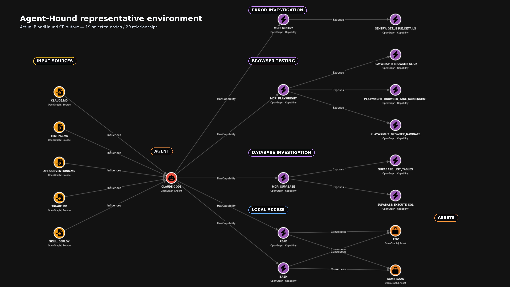
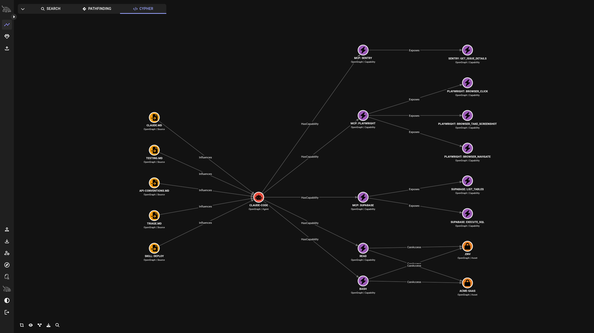

# Black Hat Arsenal representative sample

This reproducible sample models a developer using Claude Code to build and investigate a small SaaS web application. It shows configured and discoverable inputs, built-in tools, three MCP servers and representative advertised tools, plus an ignored `.env` and the local Git repository.



This image is an actual BloodHound CE graph capture. The presentation version only adds headings and group labels; it does not redraw BloodHound nodes, icons, edges, or labels.

## Representative view

The complete export contains **98 nodes and 99 edges**. [`main-graph.cypher`](queries/main-graph.cypher) selects the presentation view: **19 nodes and 20 edges**.

| Kind | Selected nodes |
| --- | --- |
| Source | `CLAUDE.md`, `api-conventions.md`, `testing.md`, `triage.md`, `Skill: deploy` |
| Agent | `Claude Code` |
| Built-in | `Read`, `Bash` |
| MCP servers | `MCP: Playwright`, `MCP: Supabase`, `MCP: Sentry` |
| MCP tools | `browser_navigate`, `browser_click`, `browser_take_screenshot`, `list_tables`, `execute_sql`, `get_issue_details` |
| Asset | `.env`, `acme-saas` Git repository |

Source activation remains explicit in the JSON: `CLAUDE.md` is automatic; rules are conditional; the command and skill are on-demand. The presentation query excludes runtime-configuration sources, unselected advertised MCP tools, MCP resources, and Impact nodes without deleting them from the export.

## Regenerate

Prerequisites are Python 3.10+ and Node.js/`npx`. Pillow is only needed to add the optional presentation overlays after capturing the graph in BloodHound.

```bash
python -m pip install -e '.[mcp]'
python -m pip install pillow
bash examples/blackhat-arsenal/scripts/prepare.sh
bash examples/blackhat-arsenal/scripts/collect.sh
```

`prepare.sh` creates `build/acme-saas` as an isolated Git repository. It commits the project and instruction files, then creates `.env` from `.env.example`; `.env` contains dummy values and is ignored by Git. The script refuses to overwrite an existing build.

`collect.sh` performs one Agent-Hound scan with live MCP metadata discovery and writes [`output/agenthound-representative.json`](output/agenthound-representative.json). It uses invalid demo tokens for Supabase and Sentry. The scan starts each local MCP process and requests advertised metadata only; it does **not** call any MCP tool or perform an operation against an external service.

The checked-in fixture pins these official packages:

| Server | Package | Version | Representative tools | Definition source |
| --- | --- | ---: | --- | --- |
| Playwright | `@playwright/mcp` | `0.0.86` | `browser_navigate`, `browser_click`, `browser_take_screenshot` | [Microsoft Playwright MCP](https://github.com/microsoft/playwright-mcp) |
| Supabase | `@supabase/mcp-server-supabase` | `0.21.0` | `list_tables`, `execute_sql` | [Supabase MCP](https://github.com/supabase/mcp) |
| Sentry | `@sentry/mcp-server` | `0.51.0` | `get_issue_details` | [Sentry MCP toolkit](https://github.com/getsentry/toolkit/tree/main/packages/mcp-core) |

The verified run completed `tools/list` for all three servers: Playwright advertised 25 tools, Supabase 4, and Sentry 52. These are availability claims (`discovery_status=advertised`), not proof of authentication, authorization, invocation, or effective access.

## BloodHound demo

1. Import [`output/agenthound-representative.json`](output/agenthound-representative.json) through BloodHound CE **File Ingest**.
2. Run [`queries/main-graph.cypher`](queries/main-graph.cypher) for the complete presentation view.
3. Run [`queries/credential-path.cypher`](queries/credential-path.cypher) for `CLAUDE.md → Claude Code → Read → .env`.

The local asset edges are produced by the normal collector from the explicit `Read`/`Bash` permissions and workspace scan. No MCP server or MCP tool is connected to `.env`.

The checked-in graph was imported into BloodHound CE 9.7.1 as File Ingest **ID 9** (`Complete`). Both queries above were run successfully. The full query produced 19 nodes and 20 relationships; the credential query produced the expected four-node path.



## Presentation assets

- Clean BloodHound canvas capture: [`figures/agenthound-bloodhound-clean.png`](figures/agenthound-bloodhound-clean.png)
- README and slide overview: [`figures/agenthound-bloodhound-overview.png`](figures/agenthound-bloodhound-overview.png)
- Slide path highlight: [`figures/agenthound-bloodhound-path.png`](figures/agenthound-bloodhound-path.png)
- Actual BloodHound credential-query result: [`screenshots/agenthound-credential-path-bloodhound.png`](screenshots/agenthound-credential-path-bloodhound.png)
- Optional vector-only decorations: [`overview overlay`](figures/agenthound-bloodhound-overlay.svg) / [`path overlay`](figures/agenthound-bloodhound-path-overlay.svg)
- BloodHound queries: [`queries/`](queries/)

To refresh the presentation images, capture the main BloodHound graph as `figures/agenthound-bloodhound-clean.png` at 3840×2160, then run:

```bash
python -m pip install pillow
bash examples/blackhat-arsenal/scripts/render.sh
```

The generated 3840×2160 PNGs retain the authentic BloodHound renderer output. The SVG files are transparent, raster-free overlays only; place them over the clean PNG when editable slide annotations are useful.
